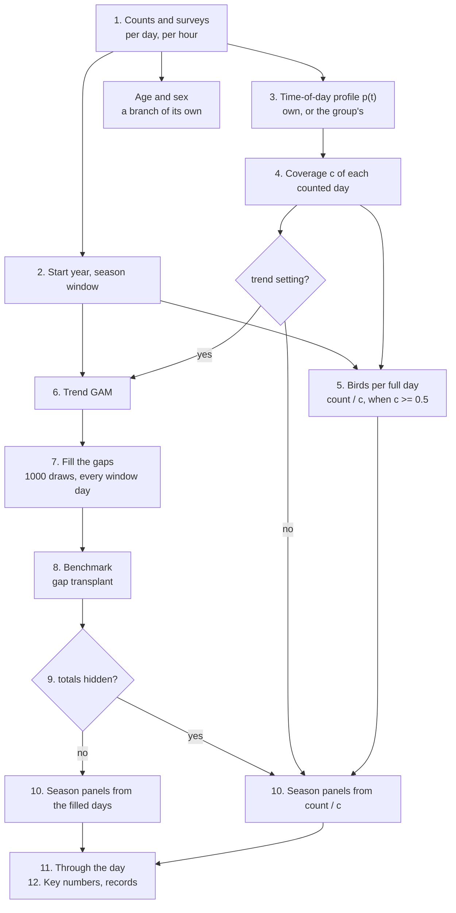

# defile-passage

Formerly defile-explore (renamed 9 November 2026: the repo models the passage, not the page).

The statistics behind the **Explore** page of [defile-website](https://github.com/Rafnuss/defile-website):
long-term trends, phenology, time of day and the other per-species views of the bird migration
counted at Défilé de l'Écluse (France) since 1966.

It reads the release of the **defile-dataset** (survey and count tables) and writes one JSON file
per taxon, which defile-website renders. The data are counts, and the page shows them as counts first:
model output (a GAM trend, gap-filled totals, annual passage-date trends) is drawn on top, never instead.

Sister repos:

- **defile-dataset**: the counts, their corrections and documentation (the input here).
- **defile-migration-forecast**: the daily migration forecast (deep learning on weather). Fully
  independent of this repo; see `DECISIONS.md` -> Repository.
- **defile-website**: the website (Vue), which shows both.

## Setup

[uv](https://docs.astral.sh/uv/) with Python 3.11; versions are pinned in `pyproject.toml` and
locked in `uv.lock`.

```bash
uv sync
uv run pytest
```

## Build the export

The counts come from a defile-dataset release: `dataset.zip` on its GitHub release `vYYYY.N`
(made there by `scripts/release_dataset.py`). `--dataset vYYYY.N` downloads it into
`raw/dataset/`, checks each table against the sha256 the dataset build gave it, and records
the tag in `release.json` and in the export's manifest. To try a dataset build before it is
released, `--dataset ../defile-dataset/output` copies it instead; such an export can only go to
the `dev` preview (below), and only if that dataset build is from committed code. A release without `parent_taxon_id` in `taxonomy.csv` is refused.

A full build writes the Explore export (`output/explore/`) and the passage tables (`output/zenodo/`,
`defile_passage.passage`): daily passage, season totals and passage dates of the 96 taxa with a
trend, as a Frictionless data package for Zenodo. Both come from the same species files.

```bash
# download a dataset release into raw/dataset/, then build output/explore/ and output/zenodo/
uv run python scripts/build_explore.py --dataset v2026.1 > logs/build.log 2>&1
# or try a local dataset build (not publishable)
uv run python scripts/build_explore.py --dataset ../defile-dataset/output > logs/build.log 2>&1

# rebuild from the same dataset (cached: seconds when only a block changed)
uv run python scripts/build_explore.py > logs/build.log 2>&1
uv run python scripts/build_explore.py --taxa "Red Kite" "Hen Harrier"   # only these taxa

# Documentation homepage, QA viewer and species comparison in output/site/
npm ci --prefix website
uv run python scripts/build_site.py

# Refresh only QA pages, without rebuilding the documentation frontend
uv run python scripts/explore_viewer.py
# species compared (trend, passage dates, their shift) -> output/site/compare/
uv run python scripts/species_compare.py
```

## Documentation website

The [methods website](https://raphaelnussbaumer.com/defile-passage/) is the technical companion to defile-website: one continuous illustrated guide at the root, an expandable QA decision table at `qa/`, and the species comparison at `compare/`, each its own page. defile-website links directly to a chapter or section with the selected species in `?species=<taxon_id>`. Old taxon URLs redirect to validation in the methods guide; the comparison's earlier URLs (`qa/compare.html`, `compare.html`) redirect to `compare/`.

The Vue sources and interactive method figures live in `website/`; the Python scripts still generate the QA output. Both read the same `output/explore/` export. Building documentation never fits statistical models. See [website/README.md](website/README.md) for editing and preview commands.

## Publish

The build runs here, not in CI (30-40 minutes on a GitHub runner); CI only runs the tests. After a
full export and `scripts/build_site.py`, from committed code in both repos (pushed here):

```bash
uv run python scripts/publish_explore.py --dry-run   # the checks and the zips only
uv run python scripts/publish_explore.py
```

It uploads `explore.zip` (the export), `passage.zip` (the passage tables, the Zenodo upload) and `viewer.zip` (the documentation homepage, QA viewer, comparison and their data) to
the rolling `dev` pre-release of this repo, replacing the previous ones, and starts
`.github/workflows/pages.yml`, which deploys the complete documentation site to GitHub Pages. defile-website downloads
`explore.zip` from that release when it deploys. `dev` is the preview: it takes an export of a
local defile-dataset build made from committed code, and the passage tables then name that build,
not a release. A versioned release (`--tag`) needs a dataset release. Both refuse an export from
uncommitted code, from another commit than HEAD or from a `--taxa` build, and passage tables or a
site from another build. The site must also be built from committed code at HEAD and from the same export. A versioned release later is `--tag`.

Time, on a 12-core Mac (all cores, `--workers` to change): a build after a new release or a
code change in the model takes about 5.5 minutes (the shared stage of time-of-day profiles,
about 2.5 minutes, then the 96 trend fits and their benchmark in parallel); one with nothing
changed takes about 15 seconds, and a change to a block downstream of the trend refits nothing
(`interim/`, `--no-cache` to ignore it). The build is verbose (pygam warnings, per-taxon
progress): redirect it to `logs/` and grep, as above; the summary at the end gives the tiers,
trends and stories. A build that stops silently with no traceback was killed from outside
(a second build started on the same folder, or a closed terminal): run it again.

The generated folders sit at the top of the repository, named as in defile-dataset, and are never
committed:

```
raw/                   what the build reads, downloaded, never edited
  dataset/             the defile-dataset release (`--dataset`)
  weather/             hourly ERA5 at the site, one file a year (Open-Meteo)
  ebird_taxonomy_fr_FR.csv   French names (`--refresh-names`)
interim/               the build's cache: shared stage, trend/ and benchmark/ fits; safe to delete
output/
  explore/             the export defile-website reads (explore.zip)
  zenodo/              the passage tables, DATA_GUIDE.md, DATA_DICTIONARY.md (passage.zip, Zenodo)
  site/                methods guide, QA and comparison (viewer.zip, GitHub Pages)
archive/               inputs of the closed research lines (scripts/research/), not built
logs/                  build logs and scratch
```

## Group taxa are read as everything below them

defile-dataset gives each taxon a `parent_taxon_id` (`taxonomy/parent_taxa.csv` there: a species
points to its smallest enclosing "sp." or slash taxon, a subspecies to its species). A taxon with
taxa below it is exported as the sum of its own birds and everything below it, at any depth, and
lists them in `members` (`export.add_rollups`): "harrier sp." is all harriers, "swallow sp." all
swallows and martins, a species its subspecies. Its trend, profile and start year are those of the
sum. A group (not a species) is left out (tier `excluded`, no page, its own series untouched) when
it is alone (fewer than `ROLLUP_MIN_BELOW` taxa below it), too large (more than
`ROLLUP_MAX_BELOW`: "bird sp.", "passerine sp.") or when one taxon is more than
`ROLLUP_MAX_SHARE` of its birds. `DECISIONS.md` has the reasoning; a wrong parent is fixed in
defile-dataset, not here.

## How a species file is made

`pipeline.build_taxon`, in order. Each species gets **one correction** of its counts: the trend
GAM's gap-filled days when it has a trend whose totals pass the test, otherwise birds per full day
(count / c). The two never stack.



| #   | Step                                                                                               | Module                 | For                          |
| --- | -------------------------------------------------------------------------------------------------- | ---------------------- | ---------------------------- |
| 1   | Read the counts and the surveys (who counted when), per day and per hour                           | `release`, `export`    | all                          |
| 2   | Start year (counted in full from) and season window (from counting coverage, one for all taxa)     | `settings`, `window`   | all                          |
| 3   | Time-of-day profile p(t): a GAM over date and civil dawn-to-dusk time, on the hourly counts        | `profile`              | all (group's if few timed)   |
| 4   | Coverage c: each counted day's share of p(t) in the minutes counted                                | `profile`              | all                          |
| 5   | Birds per full day, count / c (only when c >= 0.5); also used to choose the window (2)             | `profile`, `season`    | all; on the page only via 10 |
| 6   | Trend GAM: trend, year levels, season, timing shift, daily weather, episodes; count ~ c x exp(...) | `trend`, `weather`     | with a trend (96 of 273)     |
| 7   | Gap filling: 1000 draws of the birds missed, every window day gets a full-day value                | `trend`                | with a trend                 |
| 8   | Benchmark: recent seasons given older seasons' gaps, refilled, compared with what was counted      | `benchmark`            | with a trend                 |
| 9   | Reliability: totals, trend and season each `show`, `caveat` or `hide`                              | `reliability`          | with a trend                 |
| 10  | Season panels, passage dates, chances: from 7, or from 5 without a trend or with totals hidden     | `season`               | all (one source per species) |
| 11  | Through the day: hours counted against the profile's prediction, over the main passage             | `daytime`              | all                          |
| 11b | Weather: each term's effect (shown when clear and the same in odd and even years), wind rose       | `weather`              | with a trend                 |
| 12  | Key numbers, records, accounts                                                                     | `pipeline`, `accounts` | all                          |
| -   | Age and sex: shares among the birds classed                                                        | `demography`           | where enough birds classed   |

The illustrated documentation covers data and effort, the daily count model (including coverage), full-day reconstruction, phenology and validation. The QA table retains show/caveat/hide decisions and their numerical inputs; duplicate per-species reports are retired.

The viewer is for inspecting the model output in full detail: fits, intervals, windows, diagnostics,
method versions. What visitors see is built in defile-website, from the same species files but trimmed
and told as a story; a choice of what to show or hide (as the trend reliability classes) is defined
here, in the export, and only applied there: the viewer still draws everything, and flags on each page and
figure what defile-website will caveat or hide.

## Species and year accounts

The written accounts, in French and English, are authored in `content/accounts/` (its
[README](content/accounts/README.md) has the editorial rules): `species-sections.tsv` (a general
account per taxon) and `year-accounts.tsv` (a short account of each season). The build reads these
two files into each species file's `accounts` block; it no longer reads the report and paper
extracts of the release, which stay the editors' sources. `reading/` holds Markdown reading copies
and `review/` the editorial ledgers, both regenerated by:

```bash
uv run python scripts/accounts/check_website_account_totals.py
uv run python scripts/accounts/build_website_accounts.py
```

## Layout

```
src/defile_passage/
  release.py     reading the release tables
  export.py      raw aggregation: daily totals, effort, taxa -> JSON
  timeofday.py   the time-of-day GAM
  profile.py     effort adjustment: time-of-day profile, coverage, annual index
  trend.py       the trend GAM: smooth trend, season, timing shift, weather, gap-filled totals
  weather.py     hourly ERA5 at the site (Open-Meteo archive, raw/weather/), daily weather terms,
                 the weather block
  pipeline.py    the build: a cached shared stage, then build_taxon (all blocks of one taxon)
  settings.py    per-taxon settings by rule; overrides.yaml holds the exceptions, with reasons
  season.py      the season day by day (gap-filled by the trend, else from the counts)
  daytime.py     passage through the day, as counted
  demography.py  age and sex
  window.py      the model and view windows, the same for every taxon
  edges.py       whether a taxon still passes where regular counting starts or stops
  accounts.py    the written accounts (content/accounts/), checked and cut per taxon
  remarks.py     what the counters and reports wrote about a day (record days)
  benchmark.py   each trend tested on its own data: gap transplant, recent seasons
  reliability.py show / caveat / hide per trend claim, for defile-website to filter on
content/accounts/  the authored accounts (two TSVs), reading copies and editorial review
scripts/
  build_explore.py           the export
  build_site.py              documentation and QA site, assembled from the existing export
  explore_viewer.py          QA viewer of the export (HTML, Plotly)
  benchmark_trend.py         the benchmark with the season-only model beside the GAM (CSV)
  analyse_explore_effort.py  comparison of effort normalisations (PDF)
  analyse_time_basis.py      held-out test of the time-of-day profile's time axis (CSV)
  analyse_gap_fill.py        held-out test of gap filling: trend GAM against interpolation (CSV)
  check_entries.py           entries that look like recording errors, for the editors (CSV)
  accounts/                  editorial exports and checks of content/accounts/
tests/
```

`DECISIONS.md` records what was decided and why, `DEVELOPMENT.md` what is still open.

## License

Code: [MIT](LICENSE). The counts belong to the defile-dataset release, which has its own terms.

### Shared phenology export

`season.phenology` (`annual-date-linear@2`) contains linear fits to reconstructed annual 10%, 50% and 90% passage dates, slopes in days per year, annual 80% reconstruction intervals, and 95% trend bands. The original 1,000 joint passage-date draws are retained in `season.phenology.draws`, with the same draw index across years. It is calculated once by `phenology.phenology_block` during the Python build. Documentation, QA and defile-website consume those exported values; browsers do not refit them. The historical `trend.passage_q` field remains for compatibility and is no longer used for the primary timing display or headline.

A line is fitted separately to each joint reconstruction, using one date per year in that draw. Two residual resamples per reconstruction add between-year regression uncertainty, giving 2,000 trend draws. These bands propagate reconstruction uncertainty while preserving dependence across years; the 1,000 draws are not treated as 1,000 independent observations per year. For local work, `uv run python scripts/update_phenology.py` refreshes this derived block in an existing export that retains the joint passage-date draws, without refitting daily models, explicitly marks the export uncommitted, and preserves the base statistics revision. A complete committed build is still required before publishing. Then run `npm run explore:local` in defile-website to copy the export for local preview.
